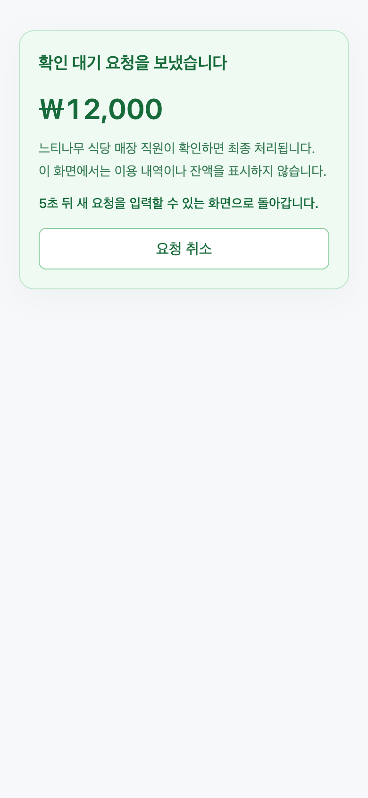
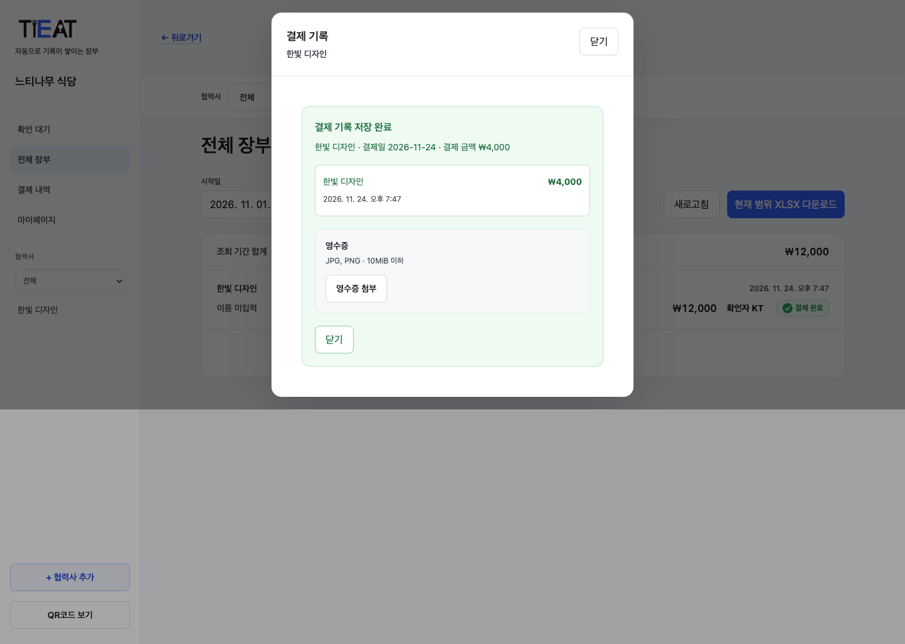

# TIEAT

TIEAT은 프랜차이즈 매장의 협력사 식대 장부 입력과 확인 업무를 줄이기 위한 장부 자동화 서비스입니다.

협력사 직원은 POS에 비치된 QR을 개인 휴대폰으로 열어 사용 금액을 입력하고, 매장 직원은 태블릿에서 거래를 확인한 뒤 자신의 이니셜로 확정합니다. 선불 계약은 남은 금액을 먼저 적용하고 초과분을 미수금으로 기록합니다.

TIEAT은 결제·충전·송금 서비스가 아닌 기록 서비스입니다.

## 서비스 데모

데모 매장에서 식대 **12,000원**을 요청하고 매장 직원이 확정하면, **선불 8,000원**과 **미수금 4,000원**이 장부에 반영됩니다.


랜딩에서 QR 입력부터 매장 확인, 정산 기록까지의 흐름

| 모바일 QR 입력 | 요청 접수 |
| --- | --- |
|  |  |
| 협력사를 검색하고 이름과 식대 금액을 입력 | 요청은 매장 직원이 확인할 때까지 대기 |

| 매장 확정 | 정산 전 장부 |
| --- | --- |
|  |  |
| 매장 직원이 금액을 확인하고 이니셜로 확정 | 확정된 식대가 장부에 올라오고, 미수금이 남은 건은 `결제 전`으로 표시 |

| POS 정산 입력 | 정산 저장 완료 |
| --- | --- |
|  |  |
| 외부 POS에서 완료한 결제의 날짜와 금액을 입력 | 미수금 4,000원에 대한 결제 기록 저장 |

| 정산 후 장부 | 결제 내역 |
| --- | --- |
|  |  |
| 미수 잔액이 0원이 되고 장부 상태가 `결제 완료`로 바뀜 | 협력사별로 저장된 결제 기록 확인 가능 |

## MVP flow

```text
QR mobile or store tablet entry
  → PENDING meal usage
  → store staff confirmation
  → CONFIRMED ledger entry
  → prepaid allocation and receivable
```

현재 저장소에는 다음과 같은 백엔드 기반이 구현되어 있습니다.

- 매장·식대 계약 범위를 가진 `MealUsage` 도메인 모델
- `PENDING → CONFIRMED` 상태 전이와 확인 이니셜
- 선불 우선 적용 및 초과 미수금 계산
- Spring Data JPA adapter와 Flyway migration
- Testcontainers PostgreSQL 통합 테스트

## Technology

- Java 25 (BellSoft Liberica)
- Spring Boot 4.1
- Gradle Kotlin DSL
- Spring MVC, Spring Security, Spring Data JPA
- PostgreSQL 18, Flyway, Testcontainers
- Docker Compose

Backend는 하나의 배포 단위를 유지하는 modular monolith입니다. 핵심 업무 규칙은 Spring과 JPA에 의존하지 않는 domain package에 두고 application use case와 adapter가 외부 기술을 연결합니다.

## Project structure

```text
apps/api
├── src/main/java/com/tieat
│   ├── ledger
│   │   ├── domain
│   │   ├── application
│   │   └── adapter
│   ├── partnership
│   └── store
└── src/main/resources/db/migration
```

## Run locally

SDKMAN을 사용하는 경우 프로젝트 SDK를 적용합니다.

```bash
sdk env
docker compose up -d postgres
./gradlew :apps:api:bootRun --args='--spring.profiles.active=local'
```

기본 API 주소는 `http://localhost:8080`이며 health endpoint는 다음과 같습니다.

```text
GET /actuator/health
```

### Public QR abuse controls

공개 QR 생성 요청은 기본적으로 client IP당 1분에 15건으로 제한되고, 요청 본문은 16KB를 넘을 수 없습니다. 여러 API 인스턴스가 같은 PostgreSQL 제한 상태를 공유합니다.

- `TIEAT_SECURITY_PUBLIC_QR_CREATE_ENABLED=false`: 사고 대응 시 생성 요청을 즉시 503으로 차단합니다.
- `TIEAT_SECURITY_PUBLIC_QR_CREATE_REQUESTS_PER_MINUTE`: 분당 허용 건수를 조정합니다.
- `TIEAT_SECURITY_PUBLIC_QR_CREATE_TRUSTED_PROXY_CIDRS`: API에 직접 연결되는 검증된 reverse proxy CIDR만 쉼표로 지정합니다. 비워 두면 `X-Forwarded-For`를 신뢰하지 않고 직접 연결 IP를 사용합니다.

운영에서는 `security_event=public_qr_create_rate_limited` 로그 발생률을 경보로 연결합니다. 이 이벤트에는 QR token이나 client IP가 기록되지 않습니다. 프록시 CIDR을 잘못 넓히면 IP 위조가 가능하므로 실제 배포 경로에서 확인한 범위만 설정해야 합니다.

### Retention worker

고객 이름 익명화 worker는 retention profile의 non-web 프로세스로 실행합니다.

```bash
./gradlew :apps:api:bootRun --args='--spring.profiles.active=retention'
```

기본 실행 시각은 매일 03:00(Asia/Seoul)이며 `TIEAT_CUSTOMER_NAME_ANONYMIZATION_CRON`으로 override할 수 있습니다. 단일 worker와 로그 실패·success count alert는 외부 플랫폼에서 연결해야 하며, 현재 저장소에는 그 증거가 없습니다.

## Deployment

파일럿 배포는 Next.js 웹과 Spring Boot API를 Docker 이미지로 빌드해 Azure Container Apps에서 실행하는 구성입니다. GitHub Actions로 이미지를 Azure Container Registry(ACR)에 게시합니다.

데이터는 Azure Database for PostgreSQL에, 영수증은 Azure Blob Storage에 저장하고 시크릿은 Azure Key Vault에서 관리합니다.

## Verify

전체 backend 검증:

```bash
./gradlew :apps:api:check --no-daemon
```

PostgreSQL 통합 테스트에는 Docker가 필요합니다.
