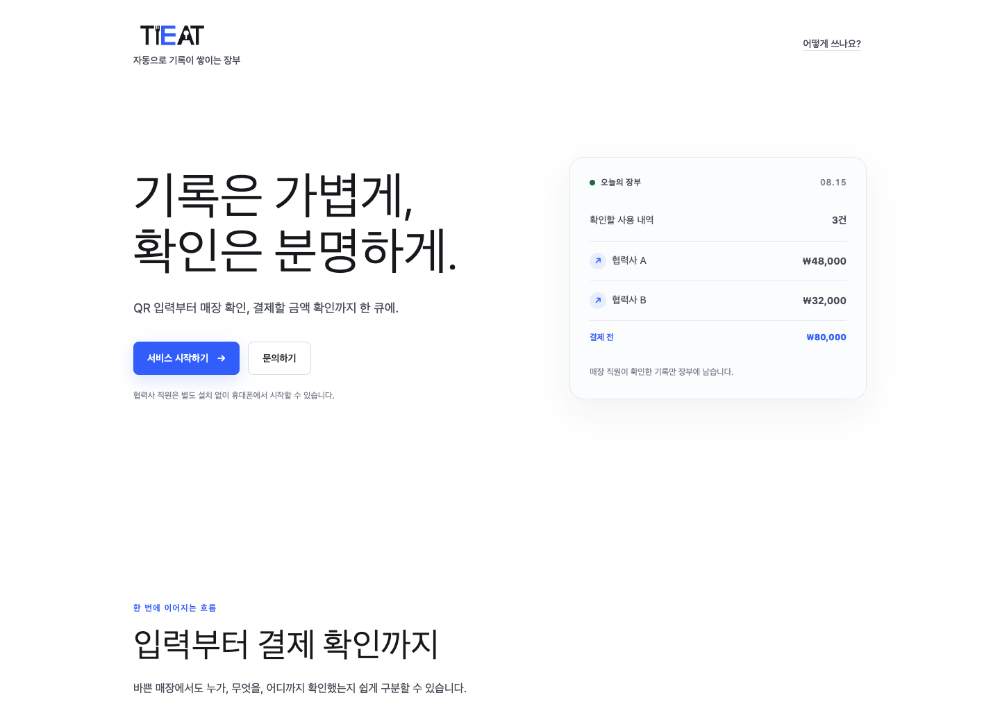
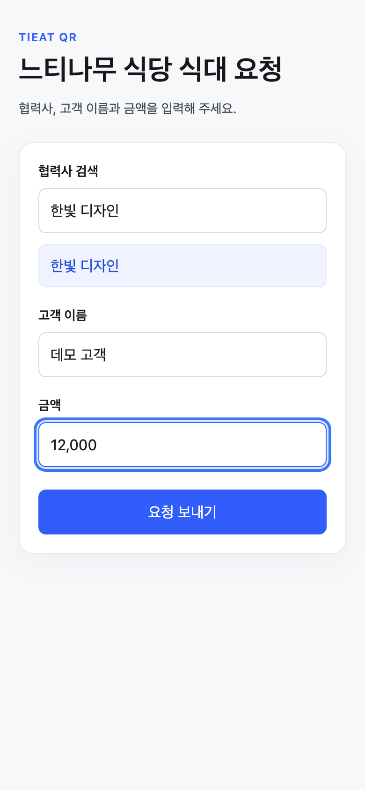
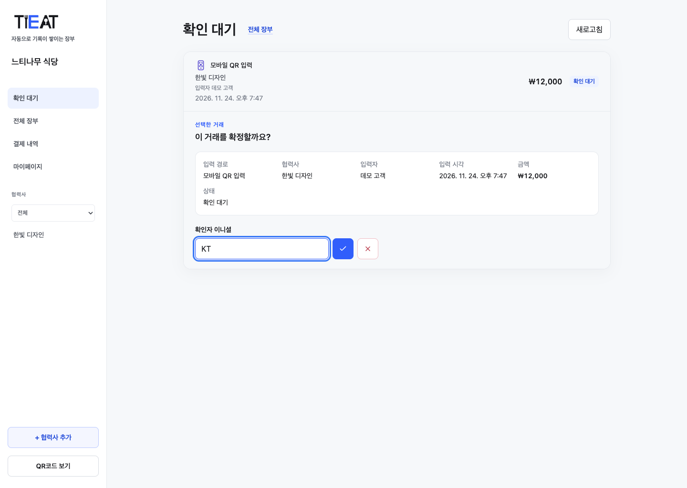
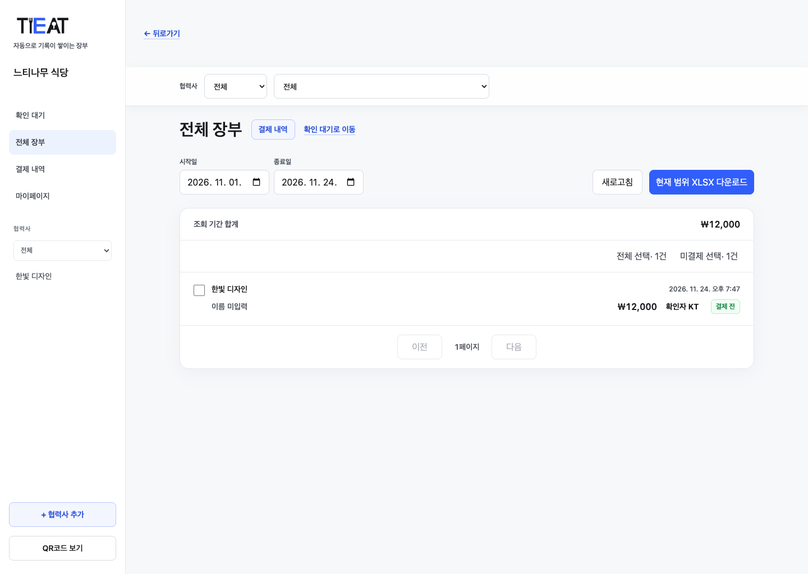
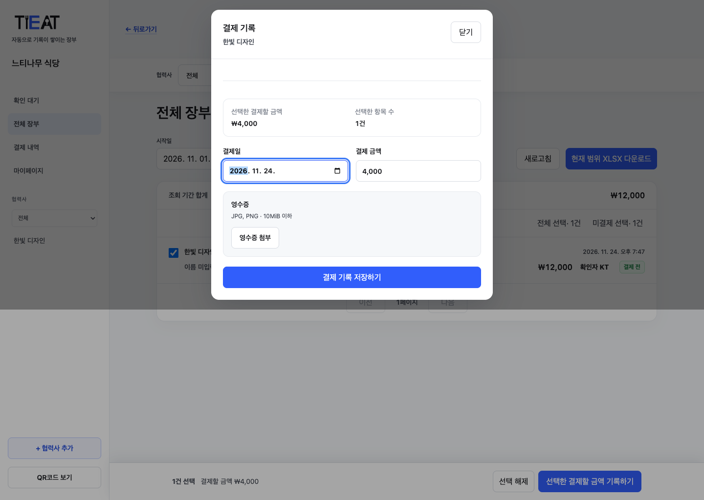
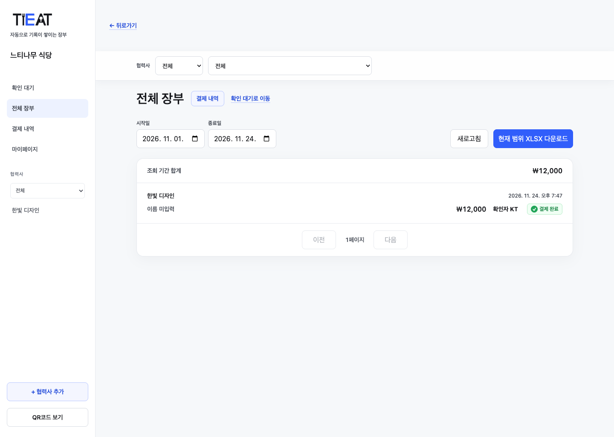
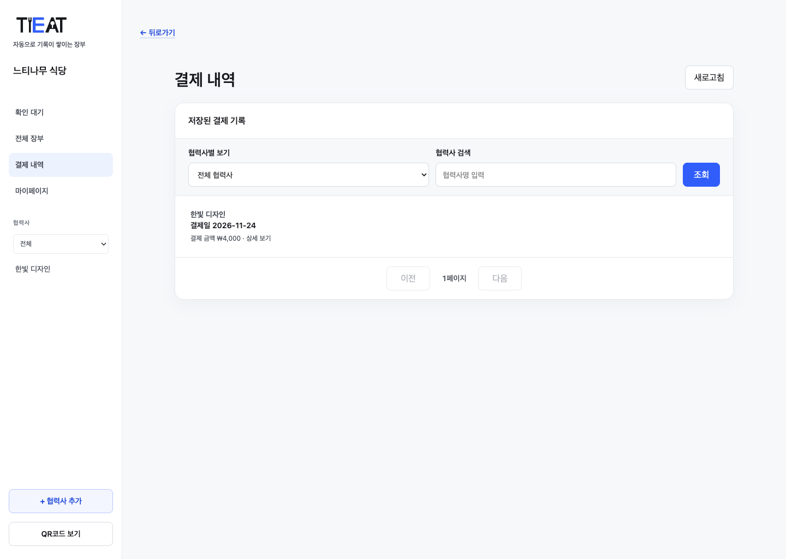
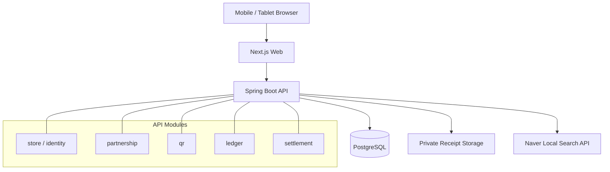

# TIEAT

> QR 입력부터 매장 확인, 장부와 정산 기록까지 한 흐름으로 연결하는 식대 관리 웹 애플리케이션


TIEAT은 매장과 협력사 사이에서 수기로 관리하던 식대 사용 내역을 디지털 장부로 전환한 프로젝트입니다. 협력사 직원은 별도 앱 없이 매장의 QR을 휴대폰으로 열어 이름과 금액을 입력하고, 매장 직원은 태블릿이나 모바일 화면에서 요청을 확인합니다. 확정된 내역은 장부와 미수금 계산에 반영되며 실제 POS 결제 결과도 별도로 기록할 수 있습니다.

TIEAT은 결제, 충전, 송금을 수행하거나 고객 자금을 보관하는 서비스가 아닙니다. 외부 POS에서 완료된 결제 사실을 장부에 기록하고 대조하는 역할에 집중합니다.

## 서비스 데모

데모 매장에서 식대 **12,000원**을 요청하고 매장 직원이 확정하면, **선불 8,000원**과 **미수금 4,000원**이 장부에 반영됩니다.



랜딩에서 QR 입력부터 매장 확인, 정산 기록까지의 흐름

| 모바일 QR 입력 | 요청 접수 |
| --- | --- |
|  |  |
| 협력사를 검색하고 이름과 식대 금액을 입력 | 요청은 매장 직원이 확인할 때까지 대기 |

| 매장 확정 | 정산 전 장부 |
| --- | --- |
|  |  |
| 매장 직원이 금액을 확인하고 이니셜로 확정 | 확정된 식대가 장부에 올라오고, 미수금이 남은 건은 `결제 전`으로 표시 |

| POS 정산 입력 | 정산 저장 완료 |
| --- | --- |
|  |  |
| 외부 POS에서 완료한 결제의 날짜와 금액을 입력 | 미수금 4,000원에 대한 결제 기록 저장 |

| 정산 후 장부 | 결제 내역 |
| --- | --- |
|  |  |
| 미수 잔액이 0원이 되고 장부 상태가 `결제 완료`로 바뀜 | 협력사별로 저장된 결제 기록 확인 가능 |

```mermaid
flowchart LR
    A[협력사 모바일<br/>QR 입력] --> B[PENDING<br/>확인 대기]
    C[매장 태블릿<br/>직접 입력] --> B
    B -->|확정 + 이니셜| D[CONFIRMED<br/>전체 장부]
    B -->|거절| E[REJECTED]
    D --> F{계약 유형}
    F -->|선불| G[잔액 우선 차감<br/>초과분은 미수금]
    F -->|후불| H[전액 미수금]
    G --> I[POS 결제 기록]
    H --> I
    I --> J[영수증 · XLSX 내보내기]
```




## 주요 기능

| 영역 | 제공 기능 |
| --- | --- |
| 매장 가입 | 매장 검색, 초대 코드 기반 가입, 첫 협력사 등록 또는 나중에 추가 |
| 협력사 관리 | 단체·개인 구분, 선불·후불 계약, 초기 선불 잔액, QR 노출 여부, 결제 조건 변경, 보관 처리 |
| QR 식대 입력 | 모바일 공개 입력, 협력사 선택, 요청 상태 확인과 취소, QR 갱신·일시 중지 |
| 확인 대기 | 들어온 요청 자동 갱신, 상세 확인, 직원 이니셜 확정, 거절 |
| 전체 장부 | 기간·협력사 필터, 결제 상태 확인, 모바일 최적화, 페이지 단위 선택 |
| 정산 기록 | 미수금 묶음 선택, POS 영업일과 결제 총액 기록, 중복 요청 방지 |
| 증빙과 내보내기 | 비공개 영수증 이미지 보관·조회, 기간별 장부 및 누적 정산 XLSX 다운로드 |
| 설치형 경험 | 앱 이름과 아이콘을 갖춘 PWA 설치 지원, 매장 장부 화면으로 바로 진입 |


## 아키텍처

백엔드는 하나의 배포 단위를 유지하는 modular monolith입니다. 업무 규칙은 Spring과 JPA에 의존하지 않는 domain package에 두고, application use case와 adapter가 HTTP, 데이터베이스, 외부 저장소를 연결합니다. 초기 제품에서 운영 복잡도를 억제하면서도 도메인 경계를 코드에 남기기 위한 선택입니다.



```text
apps/
├── api/                         # Spring Boot API
│   └── src/main/java/com/tieat
│       ├── store, identity      # 매장과 세션 인증
│       ├── partnership          # 협력사와 식대 계약
│       ├── qr                   # 공개 QR 수명 주기
│       ├── ledger               # 사용 요청과 확정 장부
│       └── settlement           # POS 정산과 영수증
└── web/                         # Next.js App Router UI
    ├── app/                     # 공개 QR, 가입, 매장 작업 공간
    └── lib/                     # API client와 응답 검증

infra/azure/                     # Azure Bicep 배포 구성
```


## 배포 구성 (최초 배포)

파일럿 배포는 Next.js 웹과 Spring Boot API를 Docker 이미지로 빌드해 Azure Container Apps에서 실행하는 구성입니다. GitHub Actions로 이미지를 Azure Container Registry(ACR)에 게시합니다.

데이터는 Azure Database for PostgreSQL에, 영수증은 Azure Blob Storage에 저장하고 시크릿은 Azure Key Vault에서 관리합니다.


